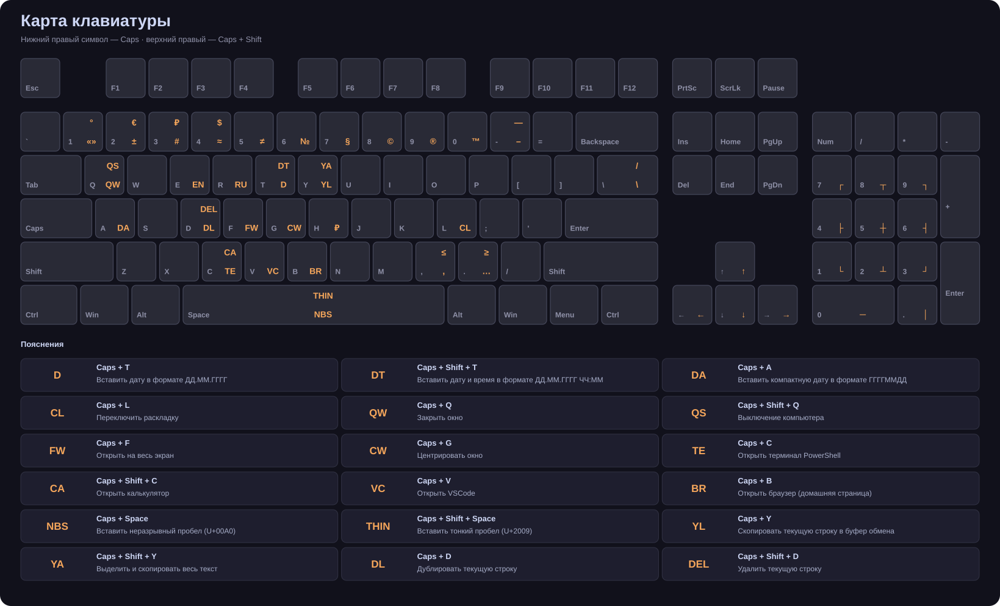

# Кастомная раскладка клавиатуры

## Полный список комбинаций

### 📅 Дата и время

| Комбинация | Действие |
|---|---|
| `Caps + T` | Вставить дату в формате ДД.ММ.ГГГГ |
| `Caps + Shift + T` | Вставить дату и время в формате ДД.ММ.ГГГГ ЧЧ:ММ |
| `Caps + A` | Вставить компактную дату в формате ГГГГММДД |

### 🌐 Переключение раскладки

| Комбинация | Действие |
|---|---|
| `Caps + E` | Переключить раскладку на English (US) |
| `Caps + R` | Переключить раскладку на Russian |
| `Caps + L` | Переключить раскладку |
| `Caps + Shift + L` | Поменять раскладку написанного текста |

### Цифровой ряд

| Комбинация | Действие |
|---|---|
| `Caps + 1` | Вставить: ° |
| `Caps + Shift + 1` | Вставить: ≈ |
| `Caps + 2` | Вставить кавычки «» и оставить курсор внутри |
| `Caps + Shift + 2` | Вставить: @ |
| `Caps + 3` | Вставить: # |
| `Caps + Shift + 3` | Вставить: № |
| `Caps + 4` | Вставить: $ |
| `Caps + 5` | Вставить: ₽ |
| `Caps + 6` | Вставить: ^ |
| `Caps + Shift + 6` | Вставить: & |
| `Caps + 7` | Вставить: ? |
| `Caps + Shift + 7` | Вставить: ¿ |
| `Caps + 8` | Вставить: ∞ |
| `Caps + Shift + 8` | Вставить: © |
| `Caps + 9` | Вставить: ✓ |
| `Caps + Shift + 9` | Вставить: ® |
| `Caps + 0` | Вставить: ✗ |
| `Caps + Shift + 0` | Вставить: ™ |
| `Caps + =` | Вставить: ± |
| `Caps + Shift + =` | Вставить: ≠ |
| `Caps + H` | Вставить: ₽ |
| `Caps + Shift + H` | Вставить: § |
| `Caps + ,` | Вставить: , |
| `Caps + Shift + ,` | Вставить: ≤ |
| `Caps + .` | Вставить: … |
| `Caps + Shift + .` | Вставить: ≥ |

### Языконезависимые символы ; : ' " [ ] { }

| Комбинация | Действие |
|---|---|
| `Caps + ;` | Вставить: ; |
| `Caps + Shift + ;` | Вставить: : |
| `Caps + NumpadDot` | Вставить вертикальную линию: │ |
| `Caps + Shift + NumpadDot` | Вставить точку |
| `Caps + [` | Вставить: [ |
| `Caps + Shift + [` | Вставить: { |
| `Caps + ]` | Вставить: ] |
| `Caps + Shift + ]` | Вставить: } |
| `Caps + '` | Вставить: ' |
| `Caps + Shift + '` | Вставить: " |

### 🎛️ Управление системой

| Комбинация | Действие |
|---|---|
| `Caps + Q` | Закрыть окно |
| `Caps + Shift + Q` | Выключение компьютера |
| `Caps + W` | Закрыть окно |
| `Caps + F` | Открыть на весь экран |
| `Caps + G` | Центрировать окно |
| `Caps + Shift + G` | Установить размер окна 1280x720 |

### 🚀 Запуск приложений

| Комбинация | Действие |
|---|---|
| `Caps + C` | Открыть терминал PowerShell |
| `Caps + Shift + C` | Открыть калькулятор |
| `Caps + V` | Открыть VSCode |
| `Caps + Shift + V` | Открыть VPN приложение |
| `Caps + B` | Открыть браузер |

### SC00C — физическая клавиша минуса: - / _

| Комбинация | Действие |
|---|---|
| `Caps + -` | Вставить короткое тире (en dash): – |
| `Caps + Shift + -` | Вставить длинное тире (em dash): — |
| `Caps + Space` | Вставить неразрывный пробел (U+00A0) |
| `Caps + Shift + Space` | Вставить тонкий пробел (U+2009) |
| `Caps + \` | Вставить \ |
| `Caps + Shift + \` | Вставить / |

### 📋 Работа со строками

| Комбинация | Действие |
|---|---|
| `Caps + Y` | Скопировать текущую строку в буфер обмена |
| `Caps + Shift + Y` | Выделить и скопировать весь текст |
| `Caps + D` | Дублировать текущую строку |
| `Caps + Shift + D` | Удалить текущую строку |
| `Caps + I` | В начало строки (Home) |
| `Caps + Shift + I` | В начало документа |
| `Caps + O` | В конец строки (End) |
| `Caps + Shift + O` | В конец документа |

### ↑ Стрелки

| Комбинация | Действие |
|---|---|
| `Caps + Up` | Вставить стрелку вверх: ↑ |
| `Caps + Down` | Вставить стрелку вниз: ↓ |
| `Caps + Left` | Вставить стрелку влево: ← |
| `Caps + Right` | Вставить стрелку вправо: → |

### Цифровой блок используется как панель для построения рамок и таблиц.

| Комбинация | Действие |
|---|---|
| `Caps + Numpad7` | Вставить верхний левый угол: ┌ |
| `Caps + Numpad8` | Вставить верхнее соединение: ┬ |
| `Caps + Numpad9` | Вставить верхний правый угол: ┐ |
| `Caps + Numpad4` | Вставить левое соединение: ├ |
| `Caps + Numpad5` | Вставить центральное соединение: ┼ |
| `Caps + Numpad6` | Вставить правое соединение: ┤ |
| `Caps + Numpad1` | Вставить нижний левый угол: └ |
| `Caps + Numpad2` | Вставить нижнее соединение: ┴ |
| `Caps + Numpad3` | Вставить нижний правый угол: ┘ |
| `Caps + Numpad0` | Вставить горизонтальную линию: ─ |
| `Caps + Numpad*` | Вставить: × (знак умножения) |
| `Caps + Numpad/` | Вставить: ÷ (знак деления) |
| `Caps + Numpad-` | Вставить: − (минус U+2212, не дефис) |

### ⚙ Сервис

| Комбинация | Действие |
|---|---|
| `Ctrl + Alt + Q` | Завершить работу скрипта |
| `LShift + RShift` | Переключить CapsLock |

_Сгенерировано: 26.10.2026 15:45_
